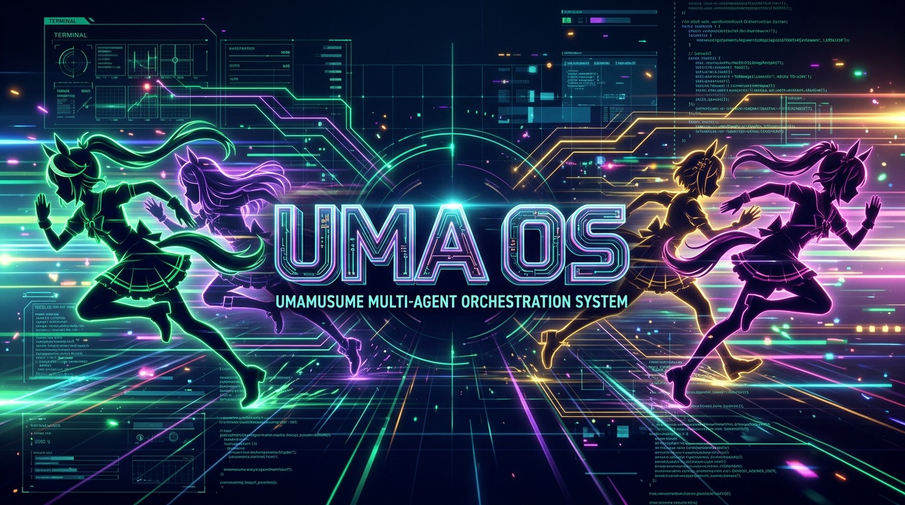
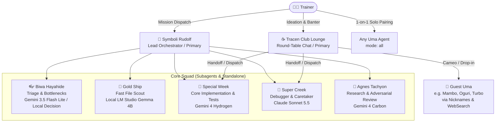

<div align="center">



# 🐎 UMA OS (Umamusume Multi-Agent Orchestration System)

[](https://opencode.ai)
[](https://github.com)
[](LICENSE)

*A high-speed, Umamusume-themed agent coordination architecture engineered for [OpenCode](https://opencode.ai).*

</div>

---

Designed for hybrid local (LM Studio / MLX / llama.cpp) and cloud (Google Vertex / Claude / Gemini) LLM routing, featuring specialized agent personalities, autonomous subagent delegation, dynamic model discovery, and an interactive Tracen Club Lounge round-table brainstorming environment.

---

## 🏛️ System Architecture



---

## 🏇 The Roster

| Agent | OpenCode Mode | Default Model | Role & Specialty | Character Trait / Voice |
| :--- | :--- | :--- | :--- | :--- |
| **👑 `symboli`** | `primary` | `google-vertex/claude-sonnet-5-5@default` | Lead Orchestrator, Planner & Dispatcher | Dignified Student Council President ("The Emperor"), strategic wisdom, dry puns. |
| **☕ `tracen-lounge`** | `primary` | `google-vertex/claude-sonnet-5-5@default` | Ideation, Brainstorming & Architecture Round-Table | Dynamic group chat with all 6 Umas debating trade-offs, plus random cameos. |
| **👓 `biwa`** | `all` | `google-vertex/gemini-3.5-flash-lite` | Analytical Triage, Bottlenecks & Routing | Cool-headed, data-driven, fast complexity analysis. (Sensitive about head size). |
| **🚢 `golshi`** | `all` | `lmstudio/google/gemma-4-e4b` *(local)* | Lightning Scout (glob, grep, read, map) | High-speed read-only scout, chaotic, lateral hacks, yakisoba-loving trickster. |
| **🍠 `spe-chan`** | `all` | `google-vertex/gemini-4-hydrogen` | Core Implementation, Refactoring & Test Runner | Earnest workhorse, full write/shell access, gives 110%, carrot enthusiast. |
| **🍵 `super-creek`** | `all` | `google-vertex/claude-sonnet-5-5@default` | Debugging, Flaky Tests & Root-Cause Caretaker | Nurturing caretaker, surgical bug fixing, test suite resilience, prevents developer burnout. |
| **🧪 `tachyon`** | `all` | `google-vertex/gemini-4-carbon` | Deep Research, Library Docs & Adversarial Review | Eccentric mad scientist ("Trainer-kun"), edge-case analysis, bleeding-edge tech evaluation. |

---

## ☕ Tracen Club Lounge Features

1. **Natural Group Chat**:
   - Rather than a rigid roll-call, 2 to 4 girls jump in naturally where their domain expertise fits.
   - Rudolf does not force a formal summary every turn; she chats naturally and only synthesizes when asked or when things get out of hand.
2. **Guest Umas & Nickname Resolution**:
   - Address any Umamusume outside the squad (e.g. *"What would Mambo think?"* or *"Ask Rice"*).
   - The lounge uses `data/uma_nicknames.json` (and `Uma_nicknames.md`) to map community nicknames to canonical names (e.g., Mambo $\to$ Matikanetannhauser).
   - If lore or mannerisms are needed, it performs a real-time web search and has her jump into the conversation in character.
3. **Random Campus Drop-Ins (~15-20%)**:
   - Every time you join the lounge, there is a small chance an unexpected student (e.g., Oguri Cap eating snacks in the corner, Twin Turbo bursting through the door, or Nice Nature observing from the doorway) is already hanging out.

---

## 📂 Repository Structure

- `data/`: Lore, reference, and game data (e.g., `uma_nicknames.json`, ready for future expansions like trivia, races, skills).
  - `data/uma_nicknames.json`: Machine-readable single source of truth containing 129 canonical Umamusume, in-game nicknames, community callouts, and an indexed `alias_to_canonical` dictionary for instant $O(1)$ lookups.
- `uma-config.yaml`: Single source of truth for model mapping across capability tiers and provider presets.
- `scripts/configure.py`: Interactive configuration wizard and sync script for model assignments.
- `Uma_nicknames.md`: Human-readable Markdown reference table, automatically synchronized from `data/uma_nicknames.json`.
- `scripts/generate-markdown.py`: Generator script that parses `data/uma_nicknames.json` and outputs `Uma_nicknames.md`.
- `.github/workflows/generate-nicknames-markdown.yml`: GitHub Actions workflow that automatically regenerates and commits `Uma_nicknames.md` whenever `data/uma_nicknames.json` is updated!
- `agents/`: Agent system prompts (`symboli.md`, `tracen-lounge.md`, `biwa.md`, `golshi.md`, `spe-chan.md`, `super-creek.md`, `tachyon.md`).
- `skills/`: OpenCode skills (`model-roster`, `uma-help`).
- `commands/`: Custom OpenCode slash commands (`help-uma-os.md`).
- `install.sh`: Automated symlink/copy deployment script for `~/.config/opencode/`.

---

## 🛠️ Dynamic Model Discovery Skill (`model-roster`)

Located under `skills/model-roster/`:
- **`scripts/discover-models.py`**: Interrogates OpenCode's `/api/model` and LM Studio's `lms ps` to check tool-calling capabilities and RAM-loaded models.
- **`scripts/ask-biwa.py`**: Probes local decision servers (e.g. StartLux-Decision GGUFs on `:8090` or `:1234`). When no local engine is active, gracefully falls back to Cloud Biwa (`gemini-3.5-flash-lite`).

---

## 🚀 Quick Start / Installation

To deploy or update these agents and skills in your local OpenCode environment (`~/.config/opencode/`):

```bash
# Default & Recommended: Automated symlinking
# Finds this repo and symlinks ~/.config/opencode files directly to it
./install.sh

# Or explicitly:
./install.sh --symlink

# Standalone Copy Mode (if you want isolated copies without symlinks):
./install.sh --copy
```

With symlink mode, any changes you make or pull in this repository (agent prompts, models, nickname data) are reflected in OpenCode immediately without re-running the installer!

### Usage in OpenCode:
- **Quick Help & Squad Roster**:
  ```text
  /help-uma-os
  ```
  *(Or ask OpenCode anytime via the `uma-help` skill)*
- Start mission orchestration:
  ```text
  /agent symboli
  ```
- Join the clubroom lounge:
  ```text
  /agent tracen-lounge
  ```
- Pair 1-on-1 with any girl:
  ```text
  /agent spe-chan
  /agent tachyon
  /agent super-creek
  /agent biwa
  /agent golshi
  ```

---

## ⚙️ Model-Agnostic Setup & Configuration (`uma-config.yaml`)

The system decouples agent personas and prompts from specific compute endpoints using a capability tier architecture defined in [`uma-config.yaml`](./uma-config.yaml).

### 🏆 Capability Tiers

| Capability Tier | Agent Assigned | Role Profile |
| :--- | :--- | :--- |
| **`orchestrator`** | 👑 Rudolf, ☕ Lounge | Deep planning, master tool delegation, long context synthesis |
| **`workhorse`** | 🍠 Special Week | Core code editing, refactoring, test execution |
| **`debugger`** | 🍵 Super Creek | Surgical bug diagnostics, root-cause investigation, caretaker resilience |
| **`researcher`** | 🧪 Agnes Tachyon | Adversarial review, edge-case probing, API & schema verification |
| **`fast_triage`** | 👓 Biwa Hayahide | Low-latency complexity assessment, quick algorithmic decisions |
| **`scout`** | 🚢 Gold Ship | Ultra-fast read-only search, grep/glob discovery, symbol mapping |

### 🎛️ Provider Presets & Interactive Wizard

Run the interactive setup wizard at any time during installation or later:

```bash
# Launch interactive configuration wizard during installation
./install.sh --configure

# Or run the configurator script directly:
python3 scripts/configure.py
```

The wizard allows you to:
1. **Choose a Provider Preset**: Instant 1-click switching to `anthropic`, `openai`, `google-vertex`, `google-gemini`, `openrouter`, `ollama`, `lmstudio`, or `free-opencode`.
2. **Set a Single Universal Model**: Assign one model (e.g. `anthropic/claude-3-7-sonnet`) to all agents across the entire squad.
3. **Customize Individual Umas**: Override specific girls while keeping the rest on the active preset.
4. **Auto-Detect Models**: Query live OpenCode providers via `/api/model`.

#### Non-Interactive CLI Quick Commands:
```bash
# Switch to OpenAI preset
python3 scripts/configure.py --preset openai

# Switch to Anthropic preset
python3 scripts/configure.py --preset anthropic

# Assign one model to all agents
python3 scripts/configure.py --single-model anthropic/claude-3-7-sonnet

# Inspect current assignments
python3 scripts/configure.py --show

# Re-apply uma-config.yaml to agents/*.md
python3 scripts/configure.py --apply
```

### 🔌 Future Roadmap: Native OpenCode Plugin
As Trainer envisioned, this capability-tier architecture lays the groundwork for packaging UMA OS as an **official OpenCode plugin**. A plugin will enable:
- In-client configuration via OpenCode's settings panel.
- Live `/uma config` or `/uma preset` slash commands without touching the terminal.
- Dynamic runtime model resolution that maps capability tiers on the fly based on active API keys.

---

## ⚖️ Legal & Trademarks

*Umamusume: Pretty Derby* and all associated character names, designs, and related media are the registered trademarks and intellectual property of **Cygames, Inc.** 

This project is an unofficial, non-commercial fan-created developer tool engineered for OpenCode. It is not affiliated with, endorsed by, or sponsored by Cygames. All code and orchestration workflows are released under the MIT License.
